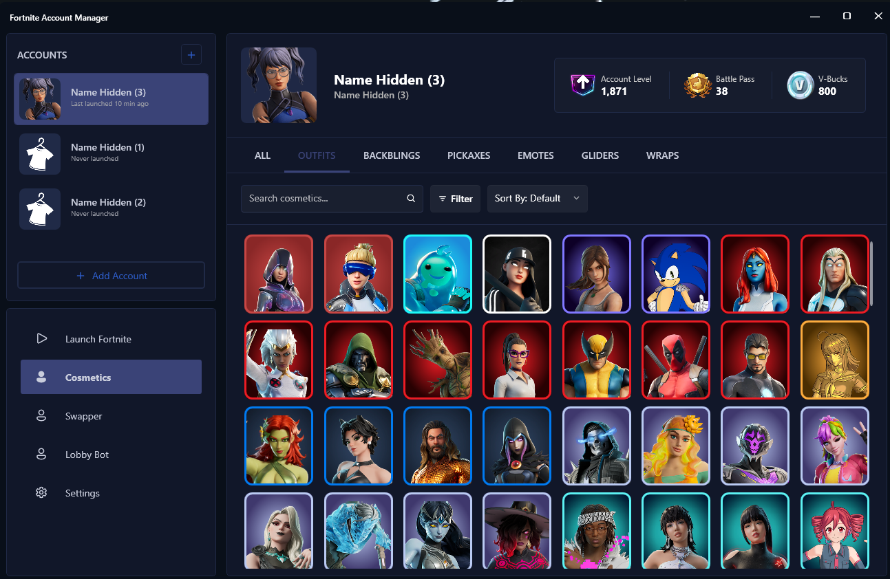

# ProLauncher
A multi-tool launcher for Fortnite

## Features
(Without a key)
- Login, manage, and launch multiple accounts
- View cosmetics on each account
- View Account Level, Battle Pass Level, V-Bucks
- View currently equipped skin

Using a key, you can access the skin swapper/skin changer.
It's basically like a resource pack for Minecraft, except for Fortnite. It does not show the swapped skin for other people. It is purely client-sided.

## Features:
(With a key)
- Swap the default Emmy skin to any skin
- Swap "No Backbling" do any backbling
- Swap compatible pickaxes (a little buggy at times)
- Swap any emote to any emote

The actual account managing is done completely on your machine. Your passwords are not held on any external servers. 

## Our Discord
If you would like to recieve support or obtain a key, please join our [discord](https://discord.com/invite/ueKadV6kCy)

### Bugs
Please report any bugs you find and I will do my best to fix them.

### Contributing
Contributions are welcome. However, if your code is sloppy; I will not merge it.